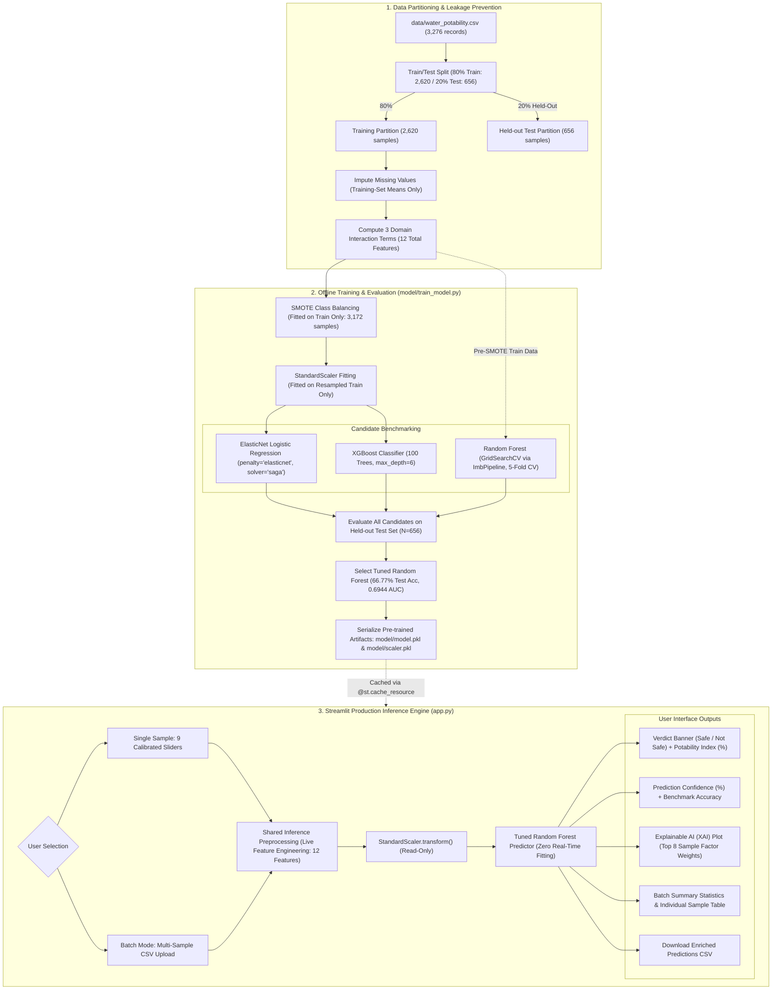
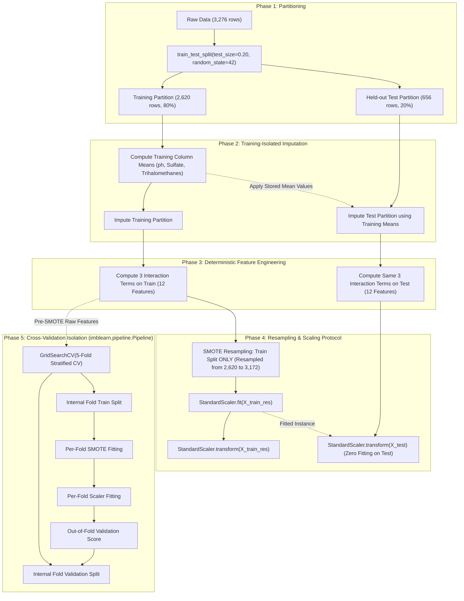
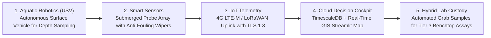

# My-3.2-project

# PureSip: Drinks Quality Prediction System

[](https://www.python.org/)
[](https://streamlit.io/)
[](https://scikit-learn.org/)
[](https://xgboost.readthedocs.io/)
[](https://docs.pytest.org/)
[](LICENSE)

An end-to-end Machine Learning web platform and decision-support system engineered to classify drinking water and beverage potability based on fundamental physicochemical characteristics, domain-specific chemical interaction features, and Explainable AI (XAI) feature attribution.

---

## Table of Contents

- [1. Project Overview](#1-project-overview)
- [2. Problem Statement & Objectives](#2-problem-statement--objectives)
- [3. Key Features](#3-key-features)
- [4. Current Development Status](#4-current-development-status)
- [5. System Architecture](#5-system-architecture)
- [6. Dataset Description & WHO Standards](#6-dataset-description--who-standards)
- [7. Feature Engineering](#7-feature-engineering)
- [8. Data Preprocessing & Leakage Prevention Pipeline](#8-data-preprocessing--leakage-prevention-pipeline)
- [9. Machine Learning Methodology & Candidate Models](#9-machine-learning-methodology--candidate-models)
- [10. Model Evaluation & Confusion Matrix](#10-model-evaluation--confusion-matrix)
- [11. Application Architecture & User Interface Guide](#11-application-architecture--user-interface-guide)
  - [Menu 1: Home Dashboard](#menu-1-home-dashboard)
  - [Menu 2: Prediction Studio (Single & Batch CSV Mode)](#menu-2-prediction-studio-single--batch-csv-mode)
  - [Menu 3: Comparison Studio](#menu-3-comparison-studio)
  - [Menu 4: Future Work (Visual Concepts & Technical Feasibility)](#menu-4-future-work-visual-concepts--technical-feasibility)
- [12. Visual Demonstration & Conceptual Assets](#12-visual-demonstration--conceptual-assets)
- [13. Model Artifacts](#13-model-artifacts)
- [14. Project Directory Structure](#14-project-directory-structure)
- [15. Installation & Environment Setup](#15-installation--environment-setup)
- [16. How to Run the Application](#16-how-to-run-the-application)
- [17. Offline Model Training Instructions](#17-offline-model-training-instructions)
- [18. Automated Testing & Verification](#18-automated-testing--verification)
- [19. Technology Stack](#19-technology-stack)
- [20. Project Limitations & Sensor Realities](#20-project-limitations--sensor-realities)
- [21. Proposed Future Roadmap](#21-proposed-future-roadmap)
- [22. Important Scientific & Health Disclaimer](#22-important-scientific--health-disclaimer)
- [23. Contributors & License](#23-contributors--license)

---

## 1. Project Overview

Access to safe, potable drinking water is a fundamental human right and a critical determinant of public health, food safety, and beverage production. In industrial, municipal, and rural contexts, raw water sources frequently suffer from mineral imbalances, chemical contamination, and unstable acidity levels that jeopardize consumer safety.

**PureSip** is an applied machine learning decision-support platform designed to evaluate whether a water sample is potable (`1`) or non-potable (`0`) using standard physicochemical water parameters. The system is architected around a **strictly non-ensemble, pre-trained single-model production deployment**:
- Following rigorous offline benchmarking against linear baselines and gradient boosted trees, an offline hyperparameter-tuned **Random Forest Classifier** was selected as the sole active production model.
- PureSip avoids complex runtime meta-classifiers (no `StackingClassifier`, no `VotingClassifier`), ensuring sub-second inference latency, deterministic execution, and transparent feature attribution.
- The platform features a synchronized, 4-menu interactive **Streamlit** user interface offering single-sample evaluation, multi-sample batch CSV processing, real-time Explainable AI (XAI) feature contribution charts, independent multi-model benchmarking, and a dedicated 5-pillar future research exploration portal.

---

## 2. Problem Statement & Objectives

### Problem Statement
Traditional water quality evaluation depends on laboratory-based certified chemical assays. While authoritative, manual wet-lab testing often incurs significant turnaround delays (hours to days), costly reagents, and complex logistics, making real-time intervention difficult. Conversely, automated decision-support software often suffers from:
1. **Data Leakage in ML Pipelines**: Applying normalization or class-balancing across the entire dataset prior to partitioning, creating overly optimistic performance metrics that degrade upon deployment.
2. **Opacity / Black-Box Predictions**: Generating binary safety predictions without indicating which specific parameters drove the outcome or deviated from safety standards.
3. **Unrealistic Deployment Claims**: Confusing laboratory-grade chemical assays (e.g., volatile organic byproducts) with low-cost field probes.

### Project Objectives
- **Build a Leak-Free Machine Learning Pipeline**: Enforce strict train-first data splitting, fold-isolated SMOTE resampling, and independent standard scaling.
- **Implement Domain-Specific Feature Engineering**: Formulate meaningful chemical interaction terms modeling mineral precipitation, ionic conductivity ratio, and disinfectant byproduct kinetics.
- **Provide Dual Prediction Modalities**: Enable both individual parameter exploration via interactive calibrated sliders and high-throughput batch evaluation via structured CSV file uploads.
- **Deliver Explainable AI (XAI)**: Compute sample-specific parameter impact scores combining model Gini feature weights with normalized sample deviations to explain individual verdicts.
- **Delineate Present Capabilities from Future Concepts**: Transparently document what the current software achieves versus proposed future integrations (aquatic robotics, IoT sensor manifolds, and cloud telemetry).

---

## 3. Key Features

- **Tuned Random Forest Production Model**: Standalone bagged ensemble of 200 decision trees hyperparameter-tuned via 5-fold cross-validation `GridSearchCV` (`accuracy = 66.77%`, `ROC-AUC = 0.6944` on held-out test data).
- **Strict Data Leakage Prevention**: Split-first protocol, training-set-only missing value imputation, and fold-isolated SMOTE class balancing using `imblearn.pipeline.Pipeline`.
- **Zero Real-Time Model Training**: The production Streamlit application performs read-only inference against serialized artifacts (`model/model.pkl`, `model/scaler.pkl`), preventing computational overhead and memory leaks.
- **Dual Prediction Workflows**:
  - **Single Sample Mode**: 9 calibrated input sliders grouped into Acidity, Disinfection/Minerals, and Organic/Clarity with instantaneous potability classification.
  - **Batch CSV Mode**: Drag-and-drop CSV batch upload with case-insensitive column validation, sample template download, batch summary statistics, and enriched CSV result export.
- **Explainable AI (XAI) Feature Attribution**: Dynamic horizontal bar plot ranking the top 8 influential factors for any specific input sample by weighting Random Forest Gini importances against sample deviations from the training distribution.
- **Independent Model Benchmarking Studio**: Side-by-side technical evaluation comparing ElasticNet Logistic Regression, XGBoost, and Tuned Random Forest on identical inputs.
- **Conceptual Future Work & Feasibility Portal**: In-depth 5-section exploration illustrating autonomous robotic sampling (USV), multi-parameter sensor arrays, dual-band IoT telemetry, real-time river GIS dashboards, and a realistic three-tier sensor feasibility breakdown.
- **Automated Test Suite**: 8 comprehensive automated tests verified via Pytest, checking AST syntax, non-stacked architecture, zero runtime fitting, feature engineering formulas, and multi-page UI rendering.
- **One-Click Windows Launcher**: Custom `run.bat` script featuring intelligent Python environment auto-detection (`.venv`, `venv`, system PATH, Anaconda).

---

## 4. Current Development Status

PureSip maintains strict transparency between implemented features, partially implemented modules, and future conceptual research:

| Category | Component / Feature | Status | Verification & Implementation Evidence |
| :--- | :--- | :---: | :--- |
| **A. Currently Implemented** | **Streamlit Web Application** | ✅ Completed | 4 synchronized menus (`app.py`), custom dark-navy CSS theming, responsive layout. |
| **A. Currently Implemented** | **Single Sample Prediction** | ✅ Completed | 9 calibrated sliders, Potability Index, Prediction Confidence, dynamic result banner. |
| **A. Currently Implemented** | **Batch CSV Prediction** | ✅ Completed | CSV upload, column auto-mapping, summary cards, enriched result CSV download. |
| **A. Currently Implemented** | **Explainable AI (XAI)** | ✅ Completed | Real-time matplotlib bar chart weighting Gini importances by standardized sample deviations. |
| **A. Currently Implemented** | **Candidate Comparison Studio** | ✅ Completed | Live side-by-side evaluation across ElasticNet, XGBoost, and Random Forest. |
| **A. Currently Implemented** | **Offline Training Pipeline** | ✅ Completed | `model/train_model.py` with leak-free `ImbPipeline`, `SMOTE`, `GridSearchCV`, artifact export. |
| **A. Currently Implemented** | **Automated Test Suite** | ✅ Completed | 8/8 tests passing (`tests/test_pipeline.py`, `tests/test_future_work.py`). |
| **A. Currently Implemented** | **Windows Launcher Script** | ✅ Completed | `run.bat` with multi-path Python and environment autodetection. |
| **B. Partially Implemented** | **Exploratory Data Analysis** | ⚠️ Experimental | `notebooks/eda.ipynb` (13 notebook cells covering initial data distributions). |
| **B. Partially Implemented** | **Legacy Page Archive** | ⚠️ Archived | `app/.pages_archive/` (historical experimental multi-page files retained for reference). |
| **C. Future Work (Proposed)** | **Aquatic Sampling Robotics (USV)** | 💡 Conceptual | Concept 1: Twin-hull catamaran USV design for depth-variable automated water collection. |
| **C. Future Work (Proposed)** | **Physical IoT Sensor Manifold** | 💡 Conceptual | Concept 2: Submerged electrochemical & optical probe cluster with mechanical wipers. |
| **C. Future Work (Proposed)** | **Cloud Telemetry & MQTT Pipeline**| 💡 Conceptual | Concept 3: Dual 4G/LoRaWAN field uplink with TLS 1.3 encryption to TimescaleDB. |
| **C. Future Work (Proposed)** | **Real-Time River GIS Dashboard** | 💡 Conceptual | Concept 4: Centralized monitoring cockpit with GIS river waypoints and anomaly alerts. |
| **C. Future Work (Proposed)** | **Sensor Feasibility Integration** | 💡 Conceptual | Concept 5: Three-tier classification separating in-situ probes from certified lab assays. |

> [!IMPORTANT]
> The robotics, physical IoT hardware, wireless transceivers, and live cloud telemetry described in Menu 4 and Section 21 represent **proposed future research concepts and visual design architectures**. They are **not** physical hardware devices currently connected to this software repository.

---

## 5. System Architecture

The following diagram illustrates the complete end-to-end data processing, offline model training, and live inference flow of the PureSip system:



---

## 6. Dataset Description & WHO Standards

PureSip is built upon the benchmark **Water Potability Dataset** (curated by Aditya Kadiwal), consisting of **3,276 individual freshwater and drinking water evaluations**.

### Partitioning & Target Distribution
- **Total Records**: 3,276 observations
- **Target Feature**: `Potability` (Binary: `1` = Potable / Safe, `0` = Non-Potable / Unsafe)
  - `Class 0 (Non-Potable)`: 1,998 samples (60.99%)
  - `Class 1 (Potable)`: 1,278 samples (39.01%)
- **Data Partitions**:
  - **Training Set (80%)**: 2,620 observations (used for imputation parameters, SMOTE resampling, and GridSearchCV)
  - **Held-Out Test Set (20%)**: 656 observations (strictly isolated from model training and scaler fitting)

### Missing Value Analysis
Missing observations are present in three parameters due to sensor dropouts in the historical dataset:
- `ph`: 491 missing entries (~15.0%)
- `Sulfate`: 781 missing entries (~23.8%)
- `Trihalomethanes`: 162 missing entries (~4.9%)

To prevent data leakage, missing values in both training and test sets are imputed strictly using the **mean values calculated from the 80% training partition only**:
- Training Mean `ph`: `7.0890`
- Training Mean `Sulfate`: `333.6533 mg/L`
- Training Mean `Trihalomethanes`: `66.3551 µg/L`

### Input Features & World Health Organization (WHO) Guidelines

| Parameter | Permissible Safe Range | Unit | WHO Significance & Health Context |
| :--- | :--- | :--- | :--- |
| **pH Level** | `6.5 – 8.5` | pH units | Measures hydrogen-ion activity. Acidic water corrodes metal conduits; alkaline water causes mineral encrustation and bitter taste. |
| **Hardness** | `< 300` | mg/L | Concentration of dissolved polyvalent metallic cations, predominantly $\text{Ca}^{2+}$ and $\text{Mg}^{2+}$. Causes soap precipitation and pipe scaling. |
| **Solids (TDS)** | `< 500` (max 1000) | ppm | Total dissolved solids (inorganic salts and small amounts of organic matter). High TDS impairs palatability and induces gastrointestinal irritation. |
| **Chloramines** | `< 4.0` | ppm | Secondary chemical disinfectant formed by adding ammonia to chlorine. Residual concentrations control biofilm without forming excessive free-chlorine odors. |
| **Sulfate** | `< 250` | mg/L | Naturally occurring mineral salt derived from mineral deposits. Elevated concentrations (> 500 mg/L) exhibit acute laxative and dehydrating effects in humans. |
| **Conductivity** | `< 400` | $\mu\text{S/cm}$ | Electrical conductivity indicating dissolved ionic concentration. Serves as a direct electrical proxy for dissolved mineral salinity. |
| **Organic Carbon** | `< 2.0` | ppm | Total Organic Carbon (TOC). Quantifies decaying natural vegetation and organic matter; reacts with disinfectants to generate hazardous byproducts. |
| **Trihalomethanes** | `< 80` | $\mu\text{g/L}$ | Volatile organohalogen byproducts (e.g., chloroform, bromoform) formed when chlorine reacts with dissolved organic matter. Chronic exposure is linked to carcinogenesis. |
| **Turbidity** | `< 5.0` (optimal < 1) | NTU | Cloudiness caused by colloidal suspended matter. Suspended particles shelter pathogenic bacteria and viruses from chlorine disinfection. |

---

## 7. Feature Engineering

To provide the non-linear models with explicit chemical interaction terms, PureSip engineer three domain-specific interaction features, expanding the input feature space from 9 to **12 total features**:

$$\begin{aligned}
\text{ph\_hardness} &= \text{ph} \times \text{Hardness} \\
\text{solids\_conductivity} &= \frac{\text{Solids}}{\text{Conductivity} + 1.0} \\
\text{chloramines\_trihalomethanes} &= \text{Chloramines} \times \text{Trihalomethanes}
\end{aligned}$$

### Chemical & Environmental Rationale
1. **$\text{pH} \times \text{Hardness}$ ($\text{ph\_hardness}$)**: Captures the equilibrium chemistry governing calcium carbonate saturation (Langelier Saturation Index dynamics). Highly alkaline water coupled with high hardness dramatically accelerates scale deposition, whereas acidic hard water causes rapid metallic leaching.
2. **$\frac{\text{Solids}}{\text{Conductivity} + 1.0}$ ($\text{solids\_conductivity}$)**: Evaluates the ratio between total dissolved mass and ionic conductance. Conductive mineral salts conduct electricity strongly, whereas non-ionic suspended organic colloids add mass without elevating conductivity. A denominator smoothing constant ($+1.0$) prevents division by zero.
3. **$\text{Chloramines} \times \text{Trihalomethanes}$ ($\text{chloramines\_trihalomethanes}$)**: Quantifies disinfection byproduct kinetics. Elevating chlorine-based disinfectants in raw water containing organic precursors directly drives trihalomethane formation.

### Verified Feature Column Ordering (12 Features)
Both `model/train_model.py` and `app.py` strictly enforce the following column sequence:
```python
FEATURE_COLS = [
    "ph", "Hardness", "Solids", "Chloramines", "Sulfate",
    "Conductivity", "Organic_carbon", "Trihalomethanes", "Turbidity",
    "ph_hardness", "solids_conductivity", "chloramines_trihalomethanes"
]
```

---

## 8. Data Preprocessing & Leakage Prevention Pipeline

Data leakage can introduce optimistic evaluation bias if transformations applied during testing or validation incorporate global distribution statistics. PureSip enforces a strict leakage prevention protocol across all training and inference stages:



1. **Partitioning Precedes Preprocessing**: The dataset is split into training (80%) and held-out test (20%) sets prior to any calculation of means or scaling parameters.
2. **Mean Preservation**: Missing values in the test set and live application inputs are imputed exclusively with training-partition means (`ph: 7.0890`, `Sulfate: 333.6533`, `Trihalomethanes: 66.3551`).
3. **Training-Only SMOTE**: Synthetic Minority Over-sampling Technique (`SMOTE`, `random_state=42`) is applied exclusively to the training partition, balancing Class 0 and Class 1 to 3,172 total training samples. The test set remains in its original empirical distribution.
4. **Fold-Independent Cross-Validation**: During hyperparameter tuning of the Random Forest model, `imblearn.pipeline.Pipeline` wraps SMOTE, StandardScaler, and the classifier. This ensures that for every cross-validation fold, synthetic samples and normalization statistics are generated purely from the fold's training slice without touching the fold's validation slice.

---

## 9. Machine Learning Methodology & Candidate Models

Three algorithms representing distinct learning paradigms were trained and evaluated offline:

### 1. ElasticNet Logistic Regression (Linear Regularized Baseline)
- **Algorithm**: `LogisticRegression(penalty='elasticnet', solver='saga', l1_ratio=0.5, max_iter=1000, random_state=42)`
- **Mechanism**: Combines $L_1$ (Lasso) and $L_2$ (Ridge) penalties to establish an optimal linear separating hyperplane.
- **Role**: Serves as the linear benchmark to assess whether water potability exhibits linear separability under standardized chemical features.

### 2. XGBoost Classifier (Gradient Boosting Candidate)
- **Algorithm**: `XGBClassifier(n_estimators=100, max_depth=6, learning_rate=0.1, eval_metric='logloss', random_state=42)`
- **Mechanism**: Sequentially constructs 100 gradient-boosted decision trees, minimizing pseudo-residual log-loss with second-order Taylor approximations.
- **Role**: Serves as the boosting candidate to evaluate sequential additive models.

### 3. Tuned Random Forest Classifier (Selected Production Model)
- **Algorithm**: `RandomForestClassifier(n_estimators=200, max_depth=None, min_samples_split=5, random_state=42)`
- **Tuning Mechanism**: 5-fold cross-validation `GridSearchCV` evaluated across `n_estimators: [100, 200]`, `max_depth: [10, 20, None]`, and `min_samples_split: [2, 5]`.
- **Optimal Parameters Found**: `{'n_estimators': 200, 'max_depth': None, 'min_samples_split': 5}`.
- **Selection Decision**: Selected as the primary production model due to superior test set generalization (66.77% accuracy) and robust variance reduction across 200 de-correlated bagged decision trees.

---

## 10. Model Evaluation & Confusion Matrix

All models were evaluated on the identical, untouched held-out test partition ($N = 656$ samples):

### Candidate Model Benchmarking Summary

| Model | Model Family | Decision Boundary | 5-Fold CV Score | Test Accuracy | Status |
| :--- | :--- | :--- | :---: | :---: | :---: |
| **ElasticNet** | Regularized Linear | Linear Hyperplane | — | **51.07%** | Linear Baseline |
| **XGBoost** | Gradient Tree Boosting | Additive Decision Trees | — | **64.48%** | Boosting Benchmark |
| **Random Forest (Tuned)** | Bagging Ensemble (200 Trees) | Orthogonal Subspace | **64.92%** | **66.77%** | 🏆 **Active Production Model** |

### Detailed Performance Metrics for Tuned Random Forest ($N = 656$)

| Evaluation Metric | Value | Mathematical Definition / Verification |
| :--- | :---: | :--- |
| **Test Accuracy** | **66.77%** | $\frac{305 + 133}{656} = 0.6677$ |
| **ROC-AUC Score** | **0.6944** | Area under the Receiver Operating Characteristic curve |
| **Precision (Class 0: Non-Potable)** | **0.7332** | $\frac{305}{305 + 111} = 0.7332$ |
| **Recall (Class 0: Non-Potable)** | **0.7403** | $\frac{305}{305 + 107} = 0.7403$ |
| **F1-Score (Class 0: Non-Potable)** | **0.7367** | Harmonic mean of Class 0 Precision and Recall |
| **Precision (Class 1: Potable)** | **0.5542** | $\frac{133}{133 + 107} = 0.5542$ |
| **Recall (Class 1: Potable)** | **0.5451** | $\frac{133}{133 + 111} = 0.5451$ |
| **F1-Score (Class 1: Potable)** | **0.5496** | Harmonic mean of Class 1 Precision and Recall |
| **Macro Average Precision** | **0.6437** | $\frac{0.7332 + 0.5542}{2} = 0.6437$ |
| **Macro Average Recall** | **0.6427** | $\frac{0.7403 + 0.5451}{2} = 0.6427$ |
| **Macro Average F1-Score** | **0.6432** | $\frac{0.7367 + 0.5496}{2} = 0.6432$ |
| **Weighted Average F1-Score** | **0.6671** | $\frac{412 \times 0.7367 + 244 \times 0.5496}{656} = 0.6671$ |

### Confusion Matrix ($N = 656$)

| Ground Truth \ Prediction | Predicted Non-Potable (`0`) | Predicted Potable (`1`) | Total Actual | Class Error Rate |
| :--- | :---: | :---: | :---: | :---: |
| **Actual Non-Potable (`0`)** | **305** (True Negative) | **107** (False Positive) | 412 | 25.97% |
| **Actual Potable (`1`)** | **111** (False Negative) | **133** (True Positive) | 244 | 45.49% |
| **Total Predicted** | 416 | 240 | **656** | — |

---

## 11. Application Architecture & User Interface Guide

PureSip is built on Streamlit with a synchronized dual-navigation structure: users can navigate via the **Sidebar Radio Menu** or the prominent **Top Navigation Bar** across four views:

```text
PureSip Web Interface
├── 🏠 Home ...................... Overview, Key Statistics, Parameter Cards & Workflow
├── 🔬 Prediction ................ Production Inference Powered by Tuned Random Forest
│   ├── Tab 1: Single Sample ..... 9 Sliders, Potability Index, Confidence & XAI Bar Chart
│   └── Tab 2: Batch CSV ......... CSV Upload, Validation, Summary Cards & Enriched Export
├── ⚖️ Comparison ................ Technical Analysis of ElasticNet vs. XGBoost vs. RF
└── 🚀 Future Work ............... 5 Focused Visual Concepts & Feasibility Explorations
```

---

### Menu 1: Home Dashboard
The landing page introduces the public health context, application objectives, and baseline system metrics:
- **Hero Card**: Highlights the intelligent assessment framework.
- **System Statistics Grid**: Displays core metrics at a glance: 9 Input Features, 3 Evaluated ML Models, and 2 Prediction Modalities.
- **Key Physicochemical Parameters**: 9 parameter cards rendered with custom SVG icons detailing each parameter's chemical identity.
- **Workflow Steps (01 Input $\rightarrow$ 02 Analysis $\rightarrow$ 03 Results)**: Clear conceptual breakdown of system execution.
- **Evaluated ML Models Matrix**: Outlines the operational roles of Random Forest (Production), XGBoost (Comparison), and ElasticNet (Baseline).
- **Public Health Disclaimer**: Explicit notice regarding the difference between machine learning estimates and certified laboratory testing.

---

### Menu 2: Prediction Studio (Single & Batch CSV Mode)
The prediction studio operates exclusively on the pre-trained, standalone **Tuned Random Forest** model without any real-time model fitting:

#### Tab 1: Single Sample Prediction
- **Input Controls**: 9 calibrated sliders grouped into:
  - *Acidity & Hardness Indicators*: pH Level (`0.0 – 14.0`), Hardness (`40.0 – 330.0 mg/L`), Total Dissolved Solids (`300.0 – 62,000.0 ppm`).
  - *Disinfection & Mineral Composition*: Chloramines (`0.0 – 15.0 ppm`), Sulfates (`120.0 – 500.0 mg/L`), Conductivity (`150.0 – 800.0 µS/cm`).
  - *Organic Matter & Clarity*: Organic Carbon (`2.0 – 30.0 ppm`), Trihalomethanes (`0.0 – 130.0 µg/L`), Turbidity (`1.0 – 7.0 NTU`).
- **Interactive Verdict Banner**:
  - `Safe for Drinking ✅`: Rendered in emerald green when $P(\text{Potable}) \ge 0.50$.
  - `NOT Safe for Drinking ⚠️`: Rendered in alert red when $P(\text{Potable}) < 0.50$.
- **Performance Sub-Metrics**: Displays the active production model name, the exact Prediction Confidence ($\max_k P(Y=k|X) \times 100$), and the model's offline benchmark accuracy (66.77%).
- **Explainable AI (XAI) Bar Chart**: Real-time horizontal bar chart ranking the top 8 influential features for the specific sample:
  $$\text{Impact}_i = \text{Importance}_i \times \left(1.0 + |z_i|\right)$$
  where $\text{Importance}_i$ is the Random Forest Gini importance for feature $i$ and $z_i$ is the standardized sample deviation.

#### Tab 2: Multiple Sample Prediction (Batch CSV Mode)
- **Sample Template Download**: Provides a pre-formatted 5-row CSV template (`puresip_water_samples_template.csv`) with the required columns.
- **File Uploader & Schema Validation**: Ingests user CSV files, executes case-insensitive column matching against the 9 required features, and alerts the user if any columns are missing.
- **Data Preview**: Expandable table inspecting the raw uploaded rows.
- **Batch Summary Dashboard**: Four metric cards displaying Total Samples Processed, Potable Count & Percentage, Non-Potable Count & Percentage, and Average Batch Confidence.
- **Enriched Results Table**: Tabular view displaying Sample IDs, Random Forest verdicts, and potability probabilities alongside optional XGBoost and ElasticNet probabilities.
- **Enriched CSV Export**: One-click download button exporting the complete dataset with attached prediction columns (`Predicted_Class`, `Prediction_Label`, `Potability_Index_Pct`, `Prediction_Confidence_Pct`).

---

### Menu 3: Comparison Studio
A technical analysis page designed for comparative machine learning evaluation:
- **Section 1: Overall Dataset Model Accuracy Benchmarks**: Side-by-side metric cards presenting the verified test accuracies for ElasticNet (51.07%), XGBoost (64.48%), and Tuned Random Forest (66.77%).
- **Benchmark Bar Chart & Architecture Matrix**: Graphical bar chart contrasting algorithm scores alongside a structured comparison of decision surface types (Linear Hyperplane vs. Additive Trees vs. Bagged Decision Trees).
- **Section 2: Live Multi-Model Evaluation on Sample Input**: An independent set of 9 sliders allowing users to evaluate a custom water sample simultaneously across all three algorithms to observe model consensus, divergence, and variance.

---

### Menu 4: Future Work (Visual Concepts & Technical Feasibility)
A research exploration portal presenting 5 development pillars bridging machine learning, physical sensing, and aquatic robotics:
1. **Autonomous Robotic Water Sampling (Aquatic Robotics)**: Catamaran Unmanned Surface Vehicle (USV) for autonomous multi-depth sampling.
2. **Multiparameter Smart Water Sensors (Sensor Hardware)**: In-situ probe cluster with anti-fouling wipers for continuous water monitoring.
3. **Cloud Data Transmission & IoT Telemetry (Telemetry Pipeline)**: Dual 4G/LoRaWAN uplink delivering sensor packets via MQTT v5 to cloud time-series storage.
4. **PureSip Smart Monitoring Dashboard (User Interface)**: Conceptual real-time cockpit with river GIS maps, live sparklines, and continuous AI scoring.
5. **Sensor Availability & Measurement Limitations (Scientific Feasibility)**: Realistic three-tier feasibility matrix distinguishing field sensors from certified laboratory assays.

---

## 12. Visual Demonstration & Conceptual Assets

PureSip includes five high-resolution technical diagrams illustrating proposed future development concepts. These visual assets reside in [`assets/future_work/`](assets/future_work/) and are rendered within Menu 4 of the live web application:

### Concept 01: Autonomous Robotic Water Sampling (USV)

*Figure 1: Conceptual Autonomous Catamaran Unmanned Surface Vehicle (USV) equipped with GPS waypoint tracking, obstacle-avoidance sonar, a variable-depth peristaltic sampling winch (0.5m – 5.0m), and a 12-chamber hermetically sealed carousel refrigerated at 4°C for laboratory custody.*

---

### Concept 02: Multiparameter Smart Water Sensor Cluster

*Figure 2: Conceptual submerged multi-parameter sensor manifold integrating optical nephelometric turbidity probes, glass pH electrodes, 4-electrode toroidal conductivity sensors, and automated mechanical anti-fouling wipers to eliminate biofilm accumulation.*

---

### Concept 03: Cloud Data Transmission & IoT Telemetry

*Figure 3: Proposed IoT telemetry architecture featuring dual-path wireless transmission (4G LTE-M with LoRaWAN fallback for remote waterways), TLS 1.3 cryptographic transport, MQTT v5 broker routing, and ingestion into a cloud time-series database (TimescaleDB).*

---

### Concept 04: PureSip Smart Monitoring Dashboard

*Figure 4: Conceptual high-level operational dashboard designed for water authorities, consolidating multi-station river telemetry, geospatial GIS USV tracks, continuous ML potability predictions, and automated anomaly warnings into a unified interface.*

---

### Concept 05: Three-Tier Sensor Feasibility Matrix

*Figure 5: Scientific feasibility matrix categorizing water quality parameters into Tier 1 (Readily accessible in-situ probes: pH, EC, Turbidity), Tier 2 (Specialized flow-cell sensors requiring reagents: Hardness, Chloramines), and Tier 3 (Laboratory-only benchtop instruments: GC-MS for Trihalomethanes, high-temperature catalytic combustion for TOC).*

---

## 13. Model Artifacts

Pre-trained models and preprocessing pipelines are serialized in the [`model/`](model/) directory and loaded once during application initialization:

| File Path | Description | Contents / Internal Keys |
| :--- | :--- | :--- |
| **`model/model.pkl`** | Serialized production artifact dictionary | • `production_model`: Standalone `RandomForestClassifier`<br>• `rf_model`: Standalone `RandomForestClassifier`<br>• `xgb_model`: Fitted `XGBClassifier`<br>• `en_model`: Fitted `LogisticRegression` (ElasticNet)<br>• `scaler`: Fitted `StandardScaler`<br>• `feature_cols`: List of 12 feature names in strict order<br>• `accuracies`: Dict of verified test accuracies<br>• `classification_reports`: Dict of complete classification reports<br>• `best_rf_params`: Hyperparameter dictionary from GridSearchCV<br>• `impute_means`: Training-set mean values for missing features |
| **`model/scaler.pkl`** | Pre-fitted normalizer artifact | Standalone fitted `StandardScaler` instance for the 12 model features |

---

## 14. Project Directory Structure

```text
water-quality-prediction-ml/
├── app.py                     # Primary Streamlit application (4 Menus, UI, & Inference Engine)
├── config.py                  # Project directory paths, base features, and global constants
├── requirements.txt           # Version-constrained Python dependencies
├── run.bat                    # One-click Windows startup script with Python environment autodetection
├── LICENSE                    # MIT License (Copyright 2026 Hassan Ali)
├── README.md                  # Comprehensive technical project documentation
│
├── .streamlit/
│   ├── config.toml            # Streamlit server port (8501), headless mode, telemetry configuration
│   └── credentials.toml       # Streamlit credentials setup
│
├── app/
│   ├── app.py                 # Synchronized mirror of root app.py
│   ├── .pages_archive/        # Archived historical experimental pages (1_EDA.py, 2_Prediction.py)
│   └── assets/
│       └── future_work/       # Mirror of future development concept diagrams
│
├── assets/
│   └── future_work/           # High-resolution conceptual diagrams (Figures 1 to 5)
│       ├── cloud_data_transmission.png
│       ├── robotic_sampling_usv.png
│       ├── sensor_limitations_lab.png
│       ├── smart_dashboard_concept.png
│       └── smart_water_sensors.png
│
├── data/
│   └── water_potability.csv   # Kaggle Physicochemical Water Quality Dataset (3,276 records)
│
├── model/
│   ├── model.pkl              # Serialized production model dictionary artifact
│   ├── scaler.pkl             # Standalone fitted StandardScaler artifact
│   └── train_model.py         # Leak-free offline training, tuning & evaluation pipeline
│
├── tests/
│   ├── test_pipeline.py       # 7 automated regression & architectural tests (pytest)
│   └── test_future_work.py    # 1 automated multi-page navigation & widget test (AppTest)
│
├── notebooks/
│   └── eda.ipynb              # Exploratory Data Analysis & distribution experiments (13 cells)
│
└── scratch/                   # Utility scripts for image generation and testing
    ├── apply_future_work.py
    └── generate_mockup_images.py
```

---

## 15. Installation & Environment Setup

### Prerequisites
- **Python**: Version `3.10`, `3.11`, `3.12`, or `3.13`
- **Package Manager**: `pip` (or Anaconda / Miniconda)
- **Version Control**: `git`

### Step-by-Step Setup

1. **Clone the Repository**:
   ```bash
   git clone https://github.com/SM-Ashik-IU/Ashik-demo-water-quality-prediction-ml-main.git
   cd Ashik-demo-water-quality-prediction-ml-main
   ```

2. **Create and Activate a Virtual Environment**:
   - **Windows (PowerShell)**:
     ```powershell
     python -m venv venv
     .\venv\Scripts\Activate.ps1
     ```
   - **Windows (Command Prompt)**:
     ```cmd
     python -m venv venv
     venv\Scripts\activate.bat
     ```
   - **Linux / macOS**:
     ```bash
     python3 -m venv venv
     source venv/bin/activate
     ```

3. **Install Dependencies**:
   ```bash
   pip install -r requirements.txt
   ```

---

## 16. How to Run the Application

PureSip runs directly using pre-trained artifacts in `model/model.pkl`. You do **not** need to retrain the models before launching the application.

### Option A: Standard Terminal Execution
From the project root directory, execute:
```bash
streamlit run app.py
```
The server will initialize and automatically open the application in your default web browser at:
```text
http://localhost:8501
```

### Option B: One-Click Windows Launcher (`run.bat`)
For Windows environments, double-click **`run.bat`** in the project root directory. The script executes an automated startup sequence:
1. Validates that `app.py` is present in the working directory.
2. Auto-detects an active Python environment by inspecting `.venv\Scripts\python.exe`, `venv\Scripts\python.exe`, system `PATH`, and standard Anaconda installations (`E:\Anaconda`, `C:\ProgramData\anaconda3`, etc.).
3. Verifies that `streamlit`, `pandas`, `scikit-learn`, `numpy`, and `matplotlib` are importable.
4. Confirms that `model/model.pkl` exists.
5. Launches `python -m streamlit run app.py` on port 8501.

---

## 17. Offline Model Training Instructions

To re-run the offline training pipeline, execute GridSearchCV tuning, and regenerate model artifacts from `data/water_potability.csv`:

```bash
python model/train_model.py
```

### Offline Training Pipeline Execution Trace:
```text
============================================================
PureSip: Starting Non-Stacked Model Training Pipeline
============================================================
[1/7] Loaded dataset: 3276 rows, 10 columns
[2/7] Split dataset: Train=2620 rows, Test=656 rows
[3/7] Feature engineering completed. Total model features: 12
[4/7] Applied SMOTE on training data only. Resampled train size: 3172
[5/7] Standard scaling fitted on train and applied to train and test sets
[6/7] Training and evaluating the 3 candidate models offline...
  -> Training ElasticNet (penalty='elasticnet', solver='saga', l1_ratio=0.5)...
     ElasticNet Test Accuracy: 51.07%
  -> Training XGBoost Classifier...
     XGBoost Test Accuracy: 64.48%
  -> Running GridSearchCV for Random Forest (5-fold CV, leak-free Pipeline)...
     Best Random Forest Parameters: {'max_depth': None, 'min_samples_split': 5, 'n_estimators': 200}
     Best Random Forest CV Score:   64.92%
     Tuned Random Forest Test Acc:  66.77%

Detailed Model Benchmarks Summary:
  1. ElasticNet:    51.07%
  2. XGBoost:       64.48%
  3. Random Forest: 66.77% (Selected Production Model)

[7/7] Saving pre-trained model artifacts...
  -> Saved artifacts dictionary to: model/model.pkl
  -> Saved fitted scaler to:        model/scaler.pkl
============================================================
Pipeline completed successfully! Ready for production inference.
============================================================
```

---

## 18. Automated Testing & Verification

PureSip includes an automated verification and compliance test suite in [`tests/`](tests/). The suite ensures that the production application strictly complies with non-stacked architecture constraints, prevents runtime fitting, verifies feature calculation consistency, and checks full multi-page UI rendering.

To execute the test suite:
```bash
python -m pytest tests/ -v
```

### Verified Test Suite Results (8/8 Passed):
```text
============================= test session starts =============================
platform win32 -- Python 3.13.9, pytest-8.4.2, pluggy-1.5.0
rootdir: d:\kaj\new 32\t32 Ashik demo  water-quality-prediction-ml-main - Copy
collected 8 items

tests/test_future_work.py::test_full_navigation_and_future_work PASSED   [ 12%]
tests/test_pipeline.py::test_app_syntax_and_structure PASSED             [ 25%]
tests/test_pipeline.py::test_non_stacked_architecture PASSED             [ 37%]
tests/test_pipeline.py::test_no_real_time_training_in_app PASSED         [ 50%]
tests/test_pipeline.py::test_feature_engineering_consistency PASSED      [ 62%]
tests/test_pipeline.py::test_rf_single_model_inference PASSED            [ 75%]
tests/test_pipeline.py::test_feature_importance_weights PASSED           [ 87%]
tests/test_pipeline.py::test_saved_metrics_consistency PASSED            [100%]

============================== 8 passed in 12.42s ==============================
```

### Test Case Descriptions:
1. `test_full_navigation_and_future_work`: Uses Streamlit's `AppTest` framework to simulate user interactions across all 4 menus (Home, Prediction, Comparison, Future Work), verifying that all 5 conceptual diagrams render and interactive widgets (selectbox, radio buttons) update without exceptions.
2. `test_app_syntax_and_structure`: Uses Python's Abstract Syntax Tree (`ast`) to parse `app.py` and verify navigation options.
3. `test_non_stacked_architecture`: Confirms that the saved production model is strictly an individual `RandomForestClassifier` and not a `StackingClassifier` or `VotingClassifier`.
4. `test_no_real_time_training_in_app`: Traverses the AST of `app.py` to ensure that no `.fit()`, `GridSearchCV`, or runtime `SMOTE` calls exist in live application code.
5. `test_feature_engineering_consistency`: Verifies that the engineered interaction formulas generate the exact expected 12-column feature vector.
6. `test_rf_single_model_inference`: Validates deterministic inference and confirms that output probabilities sum to 1.0 ($0.0 \le P \le 1.0$).
7. `test_feature_importance_weights`: Confirms that Random Forest Gini feature importances are non-negative and sum to 1.0.
8. `test_saved_metrics_consistency`: Asserts that saved dictionary metrics match verified offline benchmarks and that Random Forest is identified as the top performer.

---

## 19. Technology Stack

- **Core Programming Language**: [Python](https://www.python.org/) (Version 3.10 – 3.13)
- **Web Application Framework**: [Streamlit](https://streamlit.io/) (Session State management, custom CSS styling, AppTest testing engine)
- **Machine Learning & Preprocessing**:
  - [Scikit-Learn](https://scikit-learn.org/) (`RandomForestClassifier`, `LogisticRegression`, `GridSearchCV`, `StandardScaler`, `train_test_split`, `metrics`)
  - [XGBoost](https://xgboost.readthedocs.io/) (`XGBClassifier`)
  - [Imbalanced-Learn](https://imbalanced-learn.org/) (`SMOTE`, `imblearn.pipeline.Pipeline`)
- **Data Manipulation & Mathematics**: [Pandas](https://pandas.pydata.org/), [NumPy](https://numpy.org/)
- **Data Visualization**: [Matplotlib](https://matplotlib.org/), [Seaborn](https://seaborn.pydata.org/)
- **Quality Assurance & Verification**: [Pytest](https://docs.pytest.org/), [Streamlit AppTest](https://docs.streamlit.io/)

---

## 20. Project Limitations & Sensor Realities

While PureSip applies best-practice machine learning engineering, several important technical and environmental limitations must be noted:

1. **Dataset Scope & Moderate Accuracy**: The production Random Forest model achieves **66.77% test accuracy** ($F_1 = 0.5496$ on the Potable class). The Kaggle water potability dataset exhibits significant feature overlap between potable and non-potable samples, reflecting the reality that chemical parameters alone do not form completely distinct boundaries without microbiological and heavy metal indicators.
2. **Absence of Biological Contaminants**: The dataset lacks microbiological parameters (e.g., *Escherichia coli*, total coliform counts, enterococci, or viral loads). Water with ideal chemical indices can still cause severe waterborne diseases if microbial pathogens are present.
3. **Absence of Toxic Heavy Metals**: Heavy metal contaminants (e.g., lead, arsenic, mercury, cadmium, chromium) are not measured in the underlying dataset.
4. **Physical Sensor Boundaries (The Three-Tier Reality)**:
   - *Tier 1 (In-situ Feasible)*: pH, Electrical Conductivity, Turbidity, and temperature can be measured reliably in the field using low-power immersion probes.
   - *Tier 2 (Moderate Feasibility)*: Hardness (via Ion-Selective Electrodes) and Chloramines require frequent recalibration, flow cells, or liquid reagents.
   - *Tier 3 (Laboratory Assays Required)*: Total Organic Carbon (TOC) requires high-temperature catalytic combustion (680°C) with NDIR detection; Trihalomethanes (THMs) require purge-and-trap Gas Chromatography-Mass Spectrometry (GC-MS, EPA Method 524.2); Sulfate typically requires ion chromatography or barium precipitation turbidimetry. These parameters cannot be measured continuously by unattended miniature field probes.

---

## 21. Proposed Future Roadmap

To address these limitations, PureSip's proposed research roadmap incorporates five development pillars:



1. **Aquatic Robotics Integration (USV)**: Developing solar-assisted catamaran Unmanned Surface Vehicles (USVs) capable of autonomous GPS waypoint navigation, collision avoidance, and multi-depth peristaltic grab sampling (0.5m – 5.0m) to overcome the spatial constraints of stationary buoys.
2. **In-Situ Sensor Cluster Engineering**: Fabricating field-ready sensor manifolds with automated silicone wiper arms and ultrasonic transducers to combat biological fouling in natural water bodies.
3. **Dual-Band IoT Telemetry Mesh**: Implementing lightweight MQTT v5 messaging over cellular 4G LTE-M with long-range LoRaWAN fallback for remote waterways, feeding into time-series cloud storage (TimescaleDB).
4. **Centralized Geospatial River GIS Cockpit**: Expanding the web interface into a real-time operational cockpit mapping river corridors, color-coded potability zones, and automated anomaly alerts.
5. **Hybrid Autonomous Sampling & Laboratory Integration**: Employing in-situ probes for continuous screening while autonomously capturing refrigerated physical grab samples for laboratory certification of volatile organic compounds and heavy metals.
6. **Advanced Tabular ML Architectures**: Benchmarking deep tabular neural network architectures (e.g., TabNet, FT-Transformer) and exact TreeSHAP explanations against the Random Forest baseline.

---

## 22. Important Scientific & Health Disclaimer

> [!CAUTION]
> **IMPORTANT HEALTH & SAFETY NOTICE**:
> PureSip is an academic machine learning research and educational demonstration project. Predictions generated by this system are **probabilistic statistical estimates** derived from historical patterns in the Kaggle Water Potability Dataset.
>
> **PureSip is NOT a certified water-testing laboratory, clinical diagnostic instrument, or regulatory compliance authority.**
> - A prediction of **"Safe for Drinking ✅"** does **NOT** guarantee that a water sample is potable or free from pathogenic bacteria, viruses, toxic heavy metals (such as lead or arsenic), or harmful industrial chemicals.
> - A prediction of **"NOT Safe for Drinking ⚠️"** should be verified through certified laboratory testing before municipal or environmental compliance actions are undertaken.
>
> Determining true drinking water safety requires physical, chemical, and microbiological testing conducted in accordance with World Health Organization (WHO), US Environmental Protection Agency (EPA), or local public health authority standards. **Never consume water of unknown or questionable quality based solely on the outputs of this software.**

---

## 23. Contributors & License

### Project Contributor & Maintainer
- **Author**: S M Ashikuzzaman Ashik
- **Email**: [engr.smashikuzzaman@gmail.com](mailto:engr.smashikuzzaman@gmail.com)
- **GitHub**: [@SM-Ashik-IU](https://github.com/SM-Ashik-IU)
- **Repository**: [Ashik-demo-water-quality-prediction-ml-main](https://github.com/SM-Ashik-IU/Ashik-demo-water-quality-prediction-ml-main.git)

### Academic & Technical Acknowledgments
- **Dataset Curator**: Aditya Kadiwal ([Kaggle Water Potability Dataset](https://www.kaggle.com/datasets/adityakadiwal/water-potability)).
- **Public Health Standards**: World Health Organization (WHO) Guidelines for Drinking-water Quality (4th Edition).

### License
This project is licensed under the **MIT License**. See the [`LICENSE`](LICENSE) file for complete details:
```text
MIT License
Copyright (c) 2026 Hassan Ali
```

---

<div align="center">
  <sub>PureSip: Drinks Quality Prediction System • Academic Machine Learning Engineering & Decision Support Platform</sub>
</div>
